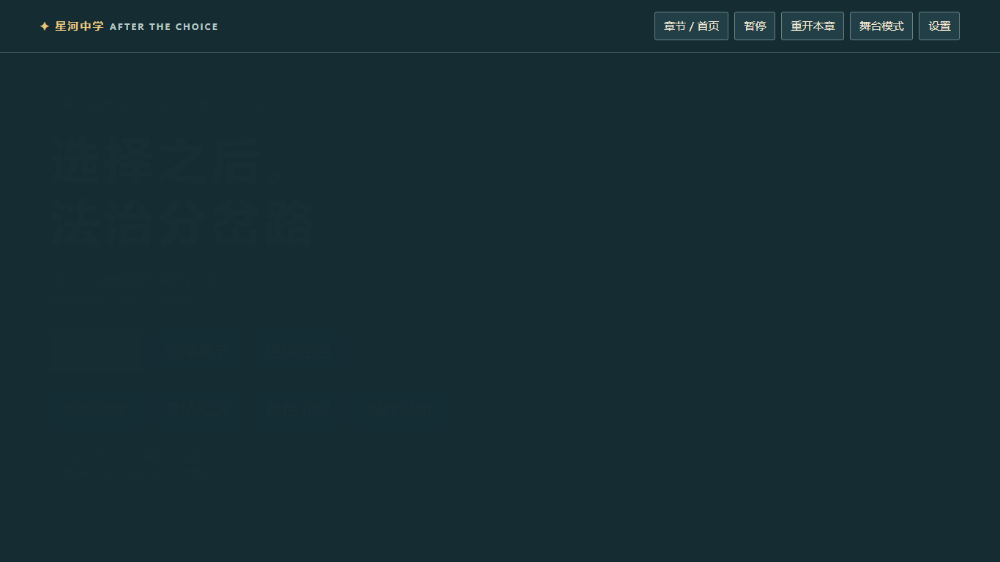

# 选择之后：法治分岔路

中文校园互动叙事游戏，适合社区共同观看与讨论。所有素材和运行代码均在本文件夹中。

**[在线体验](https://johnriver1050-glitch.github.io/after-the-choice/)** · [另一个项目：PIPL 合规辅助工具](https://github.com/johnriver1050-glitch/pipl-tool)

## 项目展示

将校园普法内容转化为可参与、可讨论的选择情境，通过分支叙事、即时反馈和法律知识卡帮助玩家理解行动后果。

- 产品设计：兼顾个人游玩与线下投影活动，提供观众投票、章节切换和大字舞台模式。
- 内容结构：四章故事、24 个双选决策、12 个可达结局。
- 技术实现：原生 JavaScript、CSS、Canvas / SVG、本地存档，无需后端即可运行。
- 验证方式：剧情图检查覆盖 96 个节点和 256 条路径，另附浏览器测试脚本。

公开仓库不包含四首背景音乐及本地离线压缩包。游戏默认静音，剧情与交互仍可完整体验；需要音乐时可在设置中载入有权使用的本地音频。

## Windows 离线启动
双击 `index.html`，用 Microsoft Edge 或 Chrome 打开即可。不需要安装 Node、不需要服务器，不依赖 CDN、fetch 或模块加载。复制整个文件夹到其他电脑即可使用。官方法律原文链接需要联网，游戏内摘要可离线阅读。

## 已实现
四章独立故事，96 个节点（含 4 个结局判定节点，92 个有实际内容的节点）、24 个双选决策、12 个可达结局、7 名原创人物、6 种校园场景及校园全景。分支影响即时后果、场景、信任、支持、处理风险和结局；第四章引用已完成章节的结局经历。

四种小游戏：多选线索、三轮传播模拟、顺序求助路线、事件分类。提供逐字对话、跳过动画、观众手动计票与玩家确认、暂停、重开、章节选择、知识卡、角色介绍、结局图鉴、关键选择回顾和完成印章。

舞台模式包含全屏与大字布局，支持键盘操作、字号设置、减少动画、静音。本机 localStorage 保存进度及结局；设置可清除。默认静音，不采集真实个人信息。

## 文件
- `index.html`：离线入口。
- `story.js`：完整人物、剧情图、效果、结局和法律卡；扩展剧情请修改此文件。
- `app.js`：状态、分支、小游戏、投票、存档与界面。
- `art.js`：原创 Canvas 场景与 SVG 角色资源，无第三方游戏素材。
- `style.css`：像素视觉与投影布局。
- `check-story.cjs`、`browser-test.cjs`：开发验证脚本。
- `现场活动操作指南.md`、`测试说明.md`：现场及验收记录。

## 开发测试
安装 Node 后运行 `node check-story.cjs`。浏览器测试需先执行 `npm install --no-save --prefix test-tools playwright`，并安装 Microsoft Edge，再执行 `node browser-test.cjs`。测试依赖不是游戏运行依赖。

## 内容边界
这是采用程序化像素美术的分支视觉小说，非自由移动地图 RPG。每章建议 8–12 分钟含讨论。传播模型仅用于说明选择影响，不预测现实传播人数。求助者不因沉默或迟疑受罚；支持指标表示旁观者行动，不是人物道德或法律评分。没有任何结局要求受伤害者原谅。

法律摘要依据网信办、教育部和中国政府网官方文本，核对日期为 2026-11-06。知识卡将法律要求与一般安全建议、情境判断分开；不以游戏选择代替具体案件认定。法律来源链接见游戏知识卡。

浏览器可能限制 file 协议下的本地存储；游戏会提示，仍可继续游玩。同一浏览器、同一路径更适合保留存档。物理投影设备与现场音响仍需工作人员提前试用。

## 配乐与音效更新
本地版本正常流程使用《落山》；《有人认真听见》使用《夏至》；四个延迟求助/处理结局使用 unhappy；其余七个结局使用《雲流れ》。公开仓库不分发这些 MP3。设置可载入本地音频、调整音乐及音效音量。取消静音后启用；离线固定文件名见 audio/配乐说明.txt。原创音效已内置，无需音频素材。

